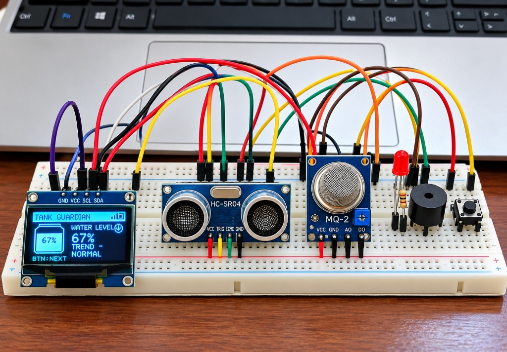
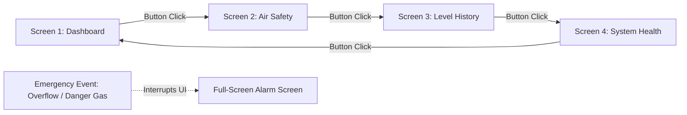
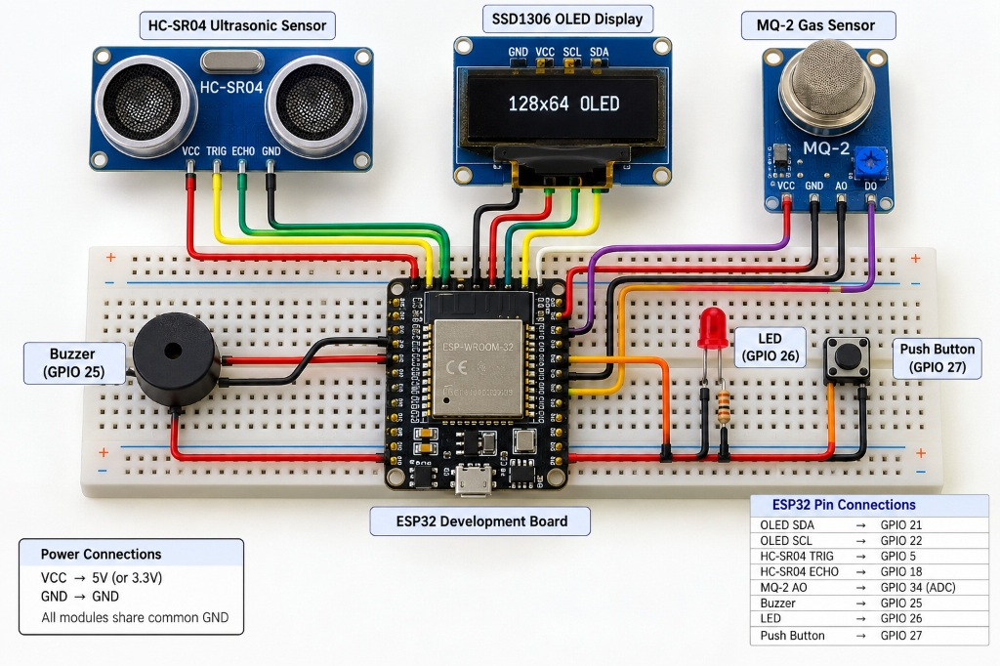

# 🛡️ Smart Tank Guardian (ESP32)

[](https://www.espressif.com/)
[](https://www.arduino.cc/)
[](https://github.com/olikraus/u8g2)
[](LICENSE)

An intelligent, multi-parameter IoT safety and monitoring system built on the **ESP32 microcontroller**. **Smart Tank Guardian** monitors liquid tank levels in real time using ultrasonic sensing, tracks air quality and hazardous gas build-up via an MQ-series analog gas sensor, provides real-time historical graphs and diagnostics on a 1.3" SH1106 OLED display, and sounds multi-tiered audio-visual alarms during overflow, water shortage, or gas leak emergencies.

---

## 📸 Working Prototype

<p align="center">
  
</p>

---

## ✨ Key Features

- **🌊 Real-Time Ultrasonic Level Sensing**: Measures liquid height using an HC-SR04 ultrasonic sensor with rolling 5-sample averaging to filter acoustic jitter and surface turbulence.
- **📊 Dynamic Wave & Bubble OLED Animation**: Custom-rendered liquid graphic with animated surface waves, rising bubbles, and percentage indicators on a 1.3-inch SH1106 I2C OLED display.
- **📈 Water Level Trend Analysis**: Calculates real-time status trends (`RISING ▲`, `FALLING ▼`, `STABLE —`, or `WAITING`) by tracking state differentials.
- **☣️ Multi-Stage Gas & Air Quality Monitoring**: Interfaced with an MQ-series gas sensor. Features an automatic 30-second thermal warmup period, baseline drift compensation, and dual-threshold warning/danger detection.
- **📉 Rolling 24-Point Historical Graph**: On-device graphical trend buffer visualizing water levels over time along with recorded peak maximums.
- **🩺 Self-Diagnostic System Health Screen**: Live diagnostic validation for I2C OLED communication, ultrasonic echo response, and gas sensor readiness.
- **🔊 Multi-Tiered Alert Engine**: Distinct audible frequencies on a passive buzzer and flashing LED patterns differentiated for **Warning** (Low/High levels) vs **Danger** (Overflow / Hazardous Gas).
- **🔘 Interactive Single-Button Navigation**: Software-debounced push button cycling seamlessly through all UI monitoring screens.

---

## 🖥️ Screen Modes & UI Walkthrough

Cycle through four dedicated screens with a single press of the navigation button:



1. **Dashboard (Page 1)**: Visual animated liquid tank, live level percentage, trend symbol, system status badge (`NORMAL`, `LOW`, `HIGH`, `OVERFLOW`, `CHECK SENSOR`), and RF signal icon.
2. **Air Safety (Page 2)**: Filtered analog gas sensor value, ambient baseline tracking value, percentage bar, and safety classification (`SAFE`, `WAIT`, `WARNING`, `DANGER`).
3. **Level History (Page 3)**: Oscilloscope-style 24-point rolling level graph, recorded peak percentage, and raw distance in centimeters.
4. **System Health (Page 4)**: Diagnostic checks showing status (`OK`, `WAIT`, `ERROR`) for Ultrasonic Sensor, Gas Sensor, and OLED Display.
5. **Emergency Override Screen**: High-priority inverted flashing warning screen that automatically overrides normal display during hazardous conditions.

---

## 🔌 Circuit Diagram & Hardware Setup

<p align="center">
  
</p>

### 📌 Pin Mapping Table

| Component | Pin / Signal | ESP32 GPIO | Description / Notes |
|---|---|---|---|
| **OLED Display (SH1106 / SSD1306)** | SDA | **GPIO 21** | I2C Data line (400 kHz fast mode) |
| | SCL | **GPIO 22** | I2C Clock line |
| | VCC | **3.3V / 5V** | Power supply (check display module voltage rating) |
| | GND | **GND** | Common Ground |
| **Ultrasonic Sensor (HC-SR04)** | TRIG | **GPIO 5** | 10µs trigger pulse output |
| | ECHO | **GPIO 18** | Echo return signal (**⚠️ Must use voltage divider**) |
| | VCC | **5V** | Standard HC-SR04 requires 5V |
| | GND | **GND** | Common Ground |
| **Gas Sensor (MQ Series)** | AO | **GPIO 34** | Analog input (ADC1 Channel 6, attenuated 11dB) |
| | VCC | **5V** | MQ heater coil requires 5V supply |
| | GND | **GND** | Common Ground |
| **Passive Buzzer** | Positive (+) | **GPIO 25** | Driven with Arduino `tone()` frequency PWM |
| | Negative (-) | **GND** | Common Ground |
| **Alert LED** | Anode (+) | **GPIO 26** | Connected through a 220Ω / 330Ω current-limiting resistor |
| | Cathode (-) | **GND** | Common Ground |
| **Push Button** | Terminal 1 | **GPIO 27** | Configured with internal `INPUT_PULLUP` |
| | Terminal 2 | **GND** | Active LOW momentary press switch |

---

## ⚠️ Important Safety & Hardware Precautions

> [!WARNING]
> 1. **HC-SR04 5V Echo Pin Protection**: The HC-SR04 sensor operates at 5V, meaning its **ECHO** pin outputs 5V pulses. ESP32 GPIO pins are rated for a maximum of **3.3V**. Always use a voltage divider (e.g., 1kΩ and 2kΩ resistors) or a bidirectional level shifter to step down the ECHO signal to 3.3V before connecting to GPIO 18.
> 2. **Gas Sensor Analog Voltage**: Verify that the analog output (AO) of your MQ module does not exceed 3.3V under high gas concentration. Use a voltage divider if necessary.
> 3. **Power Isolation**: Never connect a 9V battery or unregulated high-voltage supply directly to the ESP32 3.3V rail. Feed external 5V to the `VIN` / `5V` pin, or power via USB.
> 4. **Safety Disclaimer**: MQ-series sensors are intended for educational and hobbyist indicator applications. They are not certified life-safety or industrial warning devices.

---

## 🛠️ Software & Installation Guide

### 1. Prerequisites
- **Arduino IDE** (v1.8.x or v2.x) or **VS Code + PlatformIO**
- **ESP32 Board Package**: Install via Arduino Board Manager (`https://raw.githubusercontent.com/espressif/arduino-esp32/gh-pages/package_esp32_index.json`)
- **Libraries**:
  - `U8g2` by **olikraus** (Install via Arduino Library Manager)
  - `Wire` (Built-in)
  - `math.h` (Standard C library)

### 2. Flashing the Code
1. Clone this repository:
   ```bash
   git clone https://github.com/anil7-max/Smart_Tank_Guardian.git
   cd Smart_Tank_Guardian
   ```
2. Open `Smart_Tank_Guardian.ino` in the Arduino IDE.
3. Select your board: **Tools > Board > ESP32 Arduino > ESP32 Dev Module**.
4. Select the corresponding COM port: **Tools > Port**.
5. Click **Upload**.

---

## ⚙️ Calibration & Customization

You can tune the system for your specific tank dimensions and environment at the top of `Smart_Tank_Guardian.ino`:

```cpp
// ============================================================
// USER SETTINGS
// ============================================================
const float TANK_HEIGHT_CM         = 30.0f;    // Total height of your tank in cm
const float DISTANCE_CORRECTION_CM = 0.0f;     // Sensor offset correction if recessed

// Liquid level threshold percentages
const int WATER_EMPTY_PERCENT      = 3;        // Empty alarm threshold
const int WATER_LOW_PERCENT        = 20;       // Low water refill warning
const int WATER_HIGH_PERCENT       = 85;       // High water warning
const int WATER_OVERFLOW_PERCENT   = 95;       // Emergency overflow shutoff threshold

// Gas sensor calibration parameters
const unsigned long GAS_WARMUP_TIME_MS = 30000UL; // Sensor pre-heat time (30 seconds)
const int GAS_WARNING_DELTA        = 180;      // Delta above baseline for Warning
const int GAS_DANGER_DELTA         = 400;      // Delta above baseline for Danger
```

---

## 📂 Repository Structure

```
Smart_Tank_Guardian/
├── .gitignore                      # Git ignore patterns for Arduino/PlatformIO
├── LICENSE                         # MIT License
├── README.md                       # Documentation, schematics, and setup guide
├── Smart_Tank_Guardian.ino         # Main production source code for ESP32
└── assets/
    └── images/
        ├── circuit_diagram.jpg     # Complete wiring schematic
        └── prototype_setup.jpg     # Hardware breadboard prototype photo
```

---

## 👨‍💻 Author

Developed by **[anil7-max](https://github.com/anil7-max)**

If you found this project helpful, feel free to give it a ⭐ on GitHub!
